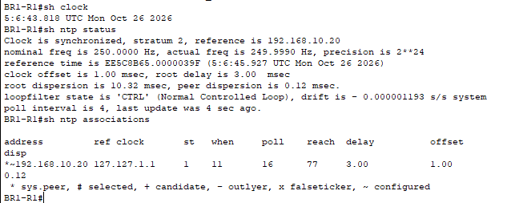
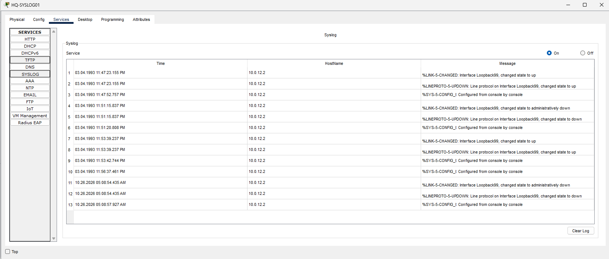
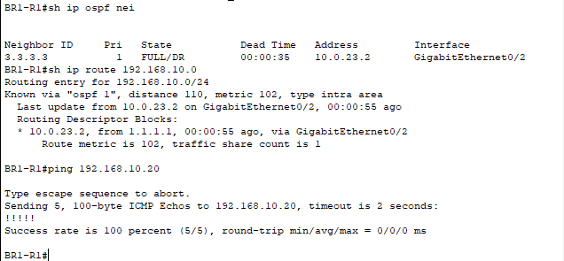
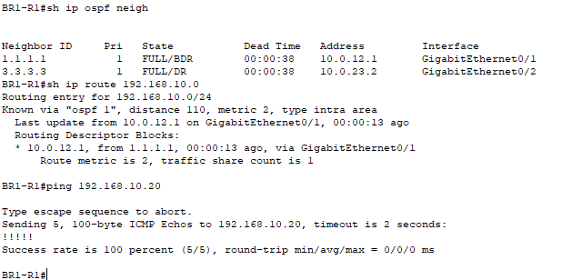

# Multisite Syslog Investigation

Centralized syslog and NTP verification in Cisco Packet Tracer, including delivery of new log messages over an OSPF backup path during a simulated WAN outage.

## Objectives

- Send BR1 router events to a central server at HQ.
- Correct the router clock using NTP and compare log timestamps.
- Verify backup routing and syslog delivery after disabling the direct HQ link.
- Restore the preferred route and confirm connectivity.

## Environment

Built in Cisco Packet Tracer 8.2.2 using three Cisco 2911 routers and Cisco 2960 switches. The existing multisite topology uses OSPF process 1, with WAN links in area 0, BR1 LAN in area 10, and BR2 LAN in area 20. Existing traffic filtering and SSH management configuration were retained.

| Device or link | Address | Purpose |
| --- | --- | --- |
| HQ LAN gateway | 192.168.10.1/24 | HQ LAN routing |
| HQ-SYSLOG01 | 192.168.10.20/24 | Syslog and NTP server; gateway 192.168.10.1 |
| BR1 LAN gateway | 192.168.20.1/24 | BR1 LAN routing |
| BR2 LAN gateway | 192.168.30.1/24 | BR2 LAN routing |
| HQ–BR1 | 10.0.12.0/30 | Preferred BR1 path to HQ |
| HQ–BR2 | 10.0.13.0/30 | BR2 path to HQ |
| BR1–BR2 | 10.0.23.0/30 | Backup BR1 path through BR2 |

The branch-to-branch interfaces have OSPF cost 100. BR1 normally reaches the HQ LAN through 10.0.12.1 with metric 2. During the test outage, it reaches that LAN through 10.0.23.2 with metric 102.

## Configuration

On HQ-SYSLOG01, enable **Services → SYSLOG** and **Services → NTP**. NTP authentication is disabled for this lab.

On BR1-R1:

```text
configure terminal
service timestamps log datetime msec
logging host 192.168.10.20
logging trap debugging
logging on
ntp server 192.168.10.20
end
```

### Packet Tracer command limitation

This simulated router rejected both `logging trap informational` and `logging trap 6`. Context help offered `debugging`, so the lab used `logging trap debugging`. This selects severity threshold 7, including severities 0–7; it does not itself enable protocol debugging.

## Investigation and Results

### 1. Verify centralized logging

A temporary Loopback99 interface generated controlled events without interrupting a production-facing link:

```text
configure terminal
interface loopback99
description SYSLOG-TEST
no shutdown
end
```

The interface had no IP address and was not advertised in OSPF. Using `shutdown` and `no shutdown` generated interface and line-protocol state changes. HQ-SYSLOG01 received messages including:

```text
%LINK-5-CHANGED
%LINEPROTO-5-UPDOWN
%SYS-5-CONFIG_I
```

These observed messages carry severity 5 (notification). Before the WAN outage, the server displayed BR1 source address **10.0.12.2**.

### 2. Investigate incorrect timestamps

The initial router clock showed March 4, 1993. After configuring NTP, verification showed:

```text
show clock
show ntp status
show ntp associations
```

- Clock synchronized, stratum 2.
- Reference server: 192.168.10.20.
- Association marked `*~192.168.10.20`, indicating the selected, configured peer.
- Router date changed to October 26, 2026.

Fresh syslog events used the 2026 date. Existing 1993 entries remained unchanged, preserving evidence of the earlier clock problem. Synchronization confirms agreement with the lab NTP server; it does not independently establish that server's real-world accuracy.

### 3. Simulate a direct WAN outage

From the BR1 router's local CLI, disable the direct HQ interface:

```text
configure terminal
interface gigabitEthernet0/1
shutdown
end
```

After convergence:

```text
show ip ospf neighbor
show ip route 192.168.10.0
ping 192.168.10.20
```

The BR2 neighbor (router ID 3.3.3.3) remained FULL on G0/2. BR1's route to the HQ LAN used **10.0.23.2**, metric **102**, and the server answered **5/5** pings.

With the backup route established, bringing Loopback99 up generated fresh messages. The server received these events with source **10.0.23.1**, confirming syslog delivery over the alternate path. No fixed syslog source interface was configured, so the displayed source changed with the outgoing interface.

This test proves delivery of new events after convergence. It does not prove lossless delivery during the routing transition; syslog used UDP port 514, and initial outage messages were not demonstrated as received.

### 4. Restore the preferred path

```text
configure terminal
interface gigabitEthernet0/1
no shutdown
end
```

Verification confirmed both HQ and BR2 neighbors FULL, the HQ LAN route restored through **10.0.12.1 on G0/1**, metric **2**, and **5/5** successful server pings.

The router configuration and Packet Tracer project were saved:

```text
copy running-config startup-config
```

Loopback99 remains as an unaddressed test interface in the completed lab.

## Evidence

### Clock before NTP


### NTP synchronization



### Timestamp correction



### Syslog over the backup path



### Preferred route restored



## Skills Demonstrated

- Centralized syslog configuration and event interpretation.
- NTP synchronization verification and timestamp investigation.
- OSPF neighbor, next-hop, and metric interpretation.
- Controlled failure testing and restoration.
- Correlating log source addresses with routing changes.

## Scope and Limitations

Only BR1 was configured and tested as a syslog/NTP client in this exercise. Syslog used unauthenticated UDP, and NTP authentication was disabled. This is a simulated learning environment, not a production logging security design. The evidence does not measure convergence time or guarantee that every outage event reached the server.

## Lab File

Download [multisite-syslog-investigation.pkt](multisite-syslog-investigation.pkt) and open it in Cisco Packet Tracer. Screenshots preserve observed results; dynamic logs and synchronization state may change when reopening the simulation.
